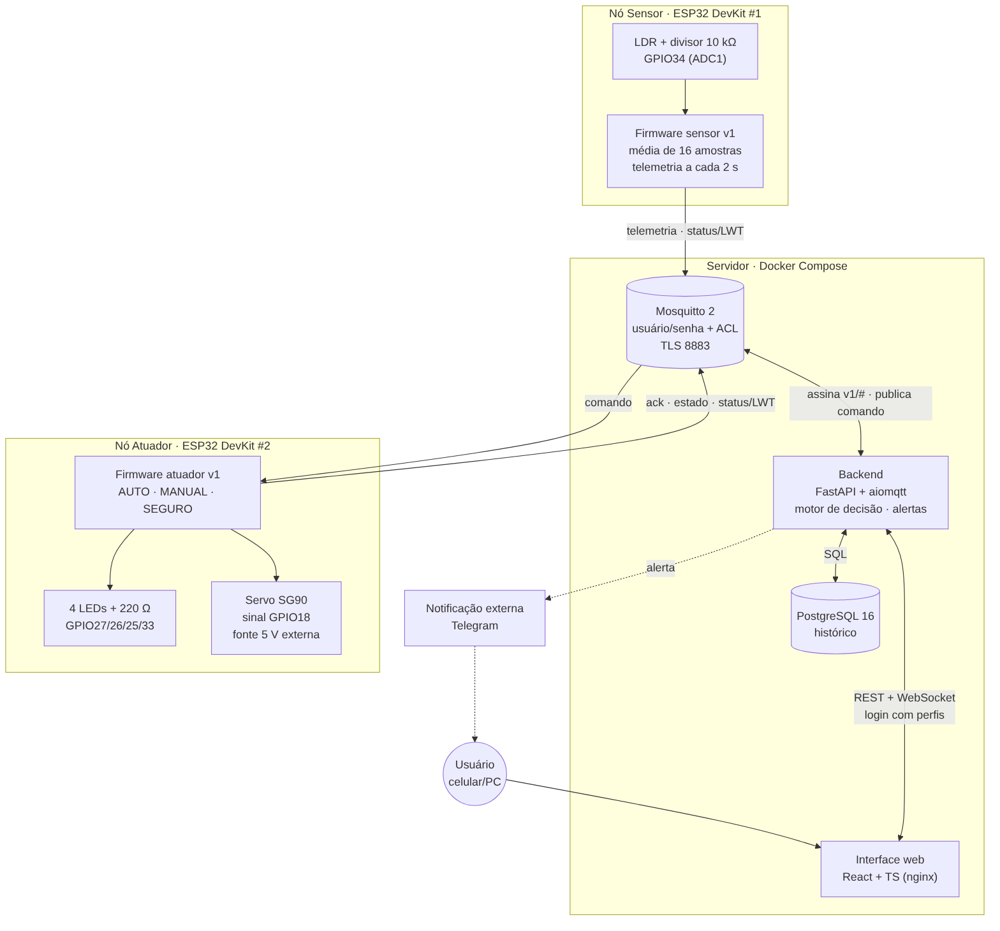

<<<<<<< HEAD
# Luz Ambiente Inteligente

Disciplina de Internet das Coisas — 6º semestre, Turma B
Família temática 3: Iluminação e ocupação

Iluminação que reage à luminosidade do ambiente: acende quando escurece,
apaga quando há luz suficiente. Som e ocupação fazem parte do desenho e do
código, mas dependem de sensores que ainda não chegaram — ver a seção
"Situação do hardware" abaixo.

```
luminosidade → LDR → ESP32 sensor → Wi-Fi/MQTT → Mosquitto
                                                     ↓
dashboard ← API/WebSocket ← FastAPI + PostgreSQL ← regra de automação
                                                     ↓ MQTT
                                       ESP32 atuador → LED → status
```

O sensor **não** controla o LED diretamente. A decisão acontece no backend e
os dispositivos se conhecem apenas pelo contrato de mensagens MQTT.

## Situação do hardware (setembro/2026)

A proposta original previa microfone, PIR e fita RGB. O que está montado hoje
é **2 ESP32, um LDR e um LED comum**. O projeto todo — backend, firmware e
documentação — está desenhado para que os componentes que faltam entrem sem
retrabalho: o código de som e de presença já existe, comentado, e liga com
uma variável de ambiente. Detalhes em
[docs/ENTREGA_N1.md](docs/ENTREGA_N1.md).

> **Pendência para o professor:** sem PIR (nem um substituto simples, como um
> botão), a metade "ocupação" da família temática ainda não é demonstrável.
> Ver [docs/RISCOS.md](docs/RISCOS.md).

## Início rápido (sem hardware)

Pré-requisito: Docker com Compose.

```bash
cp .env.example .env
docker compose up --build
```

Abra <http://localhost:8000>. Em outro terminal:

```bash
docker compose --profile tools run --rm simulator
```

No simulador, digite níveis de luz (`80`, `10`, `40`) ou `auto` para variar
sozinho. A lâmpada do dashboard muda de acordo. A API interativa fica em
<http://localhost:8000/docs>.

## Hardware

```bash
cp firmware/esp32_sensor/include/secrets.example.h firmware/esp32_sensor/include/secrets.h
cp firmware/esp32_atuador/include/secrets.example.h firmware/esp32_atuador/include/secrets.h
```

Preencha Wi-Fi e o IP do computador onde o Mosquitto roda. Nunca use
`localhost` no ESP32: para ele, esse endereço é o próprio microcontrolador.

Duas armadilhas para ler antes de montar:

- **LDR só em pinos do ADC1** (GPIO 32–36, 39). O ADC2 é compartilhado com o
  Wi-Fi e devolve lixo quando o rádio está ligado.
- **O LDR sozinho não lê nada** — precisa de um resistor formando um divisor
  de tensão. Ver [docs/MONTAGEM.md](docs/MONTAGEM.md).

## Comportamento (hoje)

| Luz | Cena | LED |
|---|---|---|
| clara | `claro` | apagado |
| escura | `suave` | aceso |

Com histerese: subir de "escuro" para "claro" exige cruzar o limiar mais uma
folga, para o LED não piscar quando a luz fica rondando o limite. Quando som
e ocupação forem ativados, a tabela ganha as faixas `media` e `festa` e a
cena `apagada` (sem ocupação) — a lógica já existe e é testada, só falta o
sensor.

Modos: **automático** (a regra decide) e **manual** (o dashboard comanda).

## Documentação

| Documento | Conteúdo |
|---|---|
| [ENTREGA_N1.md](docs/ENTREGA_N1.md) | o que mudou desde a proposta, mapa requisito → código |
| [MONTAGEM.md](docs/MONTAGEM.md) | pinagem, ordem de testes, o que muda quando os sensores chegarem |
| [CONFIGURACAO.md](docs/CONFIGURACAO.md) | `.env`, `secrets.h`, checklist de rede |
| [CONTRATO_MQTT.md](docs/CONTRATO_MQTT.md) | tópicos, payloads, QoS, retenção |
| [CALIBRACAO.md](docs/CALIBRACAO.md) | como achar os limiares de luz (e, depois, de som) |
| [RISCOS.md](docs/RISCOS.md) | riscos técnicos + pendência de escopo (ocupação) |

## Comandos úteis

```bash
docker compose up --build                    # sobe a solução
docker compose logs -f backend mosquitto     # acompanha mensagens e serviços
docker compose run --rm backend pytest       # testes da regra de automação
docker compose down                          # encerra preservando os dados
docker compose down -v                       # encerra e apaga o banco (destrutivo)
mosquitto_sub -h localhost -t 'iot/luzambiente/#' -v   # espia o barramento
```

## Integrantes

| Integrante | Frente |
|---|---|
| Rodrigo Bonifácio Conceição | circuito e testes de ligação |
| Ruan Pablo de Lima Pereira | repositório e documentação |
| Guilherme Pietro Ruiz Costa | sensor de som e calibração |
| Vinícius Clemente Negherbon | sensor de presença |
| Bianca Barp | componentes e arquitetura |

Projeto-base da disciplina:
[edsonvazlopes/Iot_salaInteligente](https://github.com/edsonvazlopes/Iot_salaInteligente).
=======
# 🌿 Luz Ambiente: proteção solar automática para plantas sensíveis

Projeto de **Internet das Coisas** com dois **ESP32** comunicando por **MQTT**. Um nó mede a luz que chega à planta e o
outro sinaliza a situação e, na versão N3, **fecha uma cobertura de sombra motorizada** quando o sol fica forte demais.

> **Entrega atual: N2 (CP12, desenho e documentação).** O documento completo está em
> [`docs/CP12_PROJETO_v1.0.md`](docs/CP12_PROJETO_v1.0.md) e o PDF entregue,
> [`docs/CP12_EQUIPE-X_PROJETO_v1.0.pdf`](docs/CP12_EQUIPE-X_PROJETO_v1.0.pdf), é gerado desse mesmo arquivo.
> O contrato MQTT foi **congelado como v1** em [`contrato/v1/`](contrato/v1/CONTRATO_v1.md).

## Problema e usuário

Plantas sensíveis (samambaias, orquídeas, mudas, suculentas recém-transplantadas) **queimam as folhas e desidratam**
quando pegam sol direto e intenso. O **usuário** é quem cultiva essas plantas em casa, na varanda, em horta urbana
ou estufa pequena e não está ao lado delas o dia todo para puxar uma sombra na hora certa.

**Proposta de valor:** *a planta se protege sozinha do sol forte e você acompanha pelo celular*. O sistema mede a luz,
fecha a sombra quando a exposição extrema se prolonga, reabre quando passa, mostra quanto tempo a planta ficou em sol
intenso e avisa se algo falhar. Também permite controle manual.

## Estado atual (herdado da N1)

| Funciona | Limitação |
|---|---|
| ESP32 sensor lê o LDR (GPIO34) e classifica em 4 cenas: escuro < 150, ambiente 150–399, alta 400–999, extrema ≥ 1000 | decisão fixa no firmware, sem histerese; valor bruto não é publicado |
| Publica `{"cena":"…"}` no HiveMQ público só quando a cena muda | broker sem senha; contrato sem versão nem ID de dispositivo |
| ESP32 atuador acende o LED da cena (4 LEDs) e publica confirmação retida | só alerta visual; confirmação não se liga ao comando |
| Dois módulos fisicamente separados (sistema distribuído real) | sem backend, banco, interface, presença/LWT ou comando remoto |

O código da N1 está em [`firmware/n1/`](firmware/n1/). A senha do Wi-Fi, que estava versionada, foi removida.

## Para onde o upgrade vai (N3)

| Camada | N1 → N3 |
|---|---|
| Hardware | + **servo SG90** para a cobertura de sombra (fonte 5 V própria, GND comum, 470 µF, pull-down no sinal) |
| Firmware | sensor só mede e publica telemetria; atuador com **máquina de estados AUTO / MANUAL / SEGURO**, intertravamento, LWT e OTA |
| Comunicação | **contrato MQTT v1** versionado, com ID de dispositivo, ack por `cmd_id` e estado retido; **Mosquitto** com usuário, ACL e TLS |
| Backend + banco | FastAPI + PostgreSQL: histórico, **decisão remota** (limites configuráveis + histerese), comandos com confirmação, alertas, Telegram |
| Interface | painel web em tempo real com gráficos, histórico e **controle manual** com login por perfil |
| Orquestração | `docker compose up` sobe broker, banco, backend e interface |

### Arquitetura-alvo



Mais diagramas: [fluxo do dado](docs/diagramas/fluxo_dado.png) · [fluxo do comando](docs/diagramas/fluxo_comando.png) ·
[fluxograma do atuador](docs/diagramas/fluxograma_atuador.png) · [fluxograma do sensor](docs/diagramas/fluxograma_sensor.png) ·
esquema elétrico do [nó sensor](docs/hardware/esquema_eletrico/esquema_sensor.png) e do [nó atuador](docs/hardware/esquema_eletrico/esquema_atuador.png) ·
[mapa de pinos](docs/hardware/mapa_de_pinos.md).

## Estrutura do repositório

```text
├── README.md
├── docs/
│   ├── CP12_PROJETO_v1.0.md          documento do checkpoint (fonte do PDF)
│   ├── CP12_EQUIPE-X_PROJETO_v1.0.pdf PDF entregue no Teams
│   ├── gerar_pdf.py                  gera o PDF a partir do .md
│   ├── diagramas/                    arquitetura, fluxos e fluxogramas (.mmd fonte + .svg/.png)
│   └── hardware/
│       ├── mapa_de_pinos.md
│       └── esquema_eletrico/         esquema.py (schemdraw) + esquema_sensor/atuador .svg/.png
├── contrato/v1/                      contrato MQTT congelado
│   ├── CONTRATO_v1.md
│   ├── schemas/*.schema.json         JSON Schema de cada mensagem
│   ├── exemplos/{validos,invalidos}/ payloads de exemplo
│   └── validar.py                    confere os exemplos contra os schemas
├── firmware/n1/                      firmware entregue na N1 (Sensor_de_luz, Atuador_LED)
└── dashboard-prototipo/              protótipo adiantado de backend + banco + interface (contrato N1)
```

## Como reproduzir os artefatos desta entrega

```bash
pip install jsonschema schemdraw matplotlib markdown playwright
python -m playwright install chromium
npm install -g @mermaid-js/mermaid-cli

python contrato/v1/validar.py                         # valida os exemplos do contrato v1
python docs/hardware/esquema_eletrico/esquema.py      # redesenha os esquemas elétricos
for f in docs/diagramas/*.mmd; do mmdc -i "$f" -o "${f%.mmd}.png" -b white -s 2; mmdc -i "$f" -o "${f%.mmd}.svg" -b white; done
python docs/gerar_pdf.py EQUIPE-X                     # gera o PDF do CP12 a partir do .md
```

Instruções completas de instalação e execução do sistema são exigidas na N3 (R11). O protótipo já tem as dele em
[`dashboard-prototipo/README.md`](dashboard-prototipo/README.md).

## ⚠️ Precauções de hardware (lições da N1)

- O ESP32 trabalha com **3,3 V**: nenhum sinal de 5 V vai direto a um GPIO.
- **Todo LED com resistor em série**; nenhuma carga alimentada por GPIO.
- Servo **sempre em fonte própria** com GND comum, nunca no 3V3 ou no VIN.
- Durante a N1 uma ligação errada inutilizou o **GPIO13**, que fica fora do projeto.
- Placas com conversor USB **CP2102** podem precisar de driver no Windows para a porta COM aparecer.

## 👥 Equipe

| Integrante | Responsabilidade (até a entrega completa) |
|---|---|
| Ruan Pablo de Lima Pereira | nó sensor: divisor/ADC, fluxograma do sensor e fluxo do dado, parâmetros de decisão; documento CP12 e PDF |
| Rodrigo Bonifácio Conceição | nó atuador: máquina de estados, intertravamento, servo |
| Vinicius Clemente Negherbon | contrato MQTT v1, repositório |
| Bianca Barp | esquema elétrico, BOM, mapa de pinos, revisão do documento |
| Guilherme Pietro | arquitetura-alvo, fluxo do comando, protótipo do dashboard, plano de falhas, cronograma e riscos |

## 📄 Licença

Projeto acadêmico, sem licença de software definida.
>>>>>>> cd9e4a04872cff4bc176a175ffbc72a3ee183ee3
