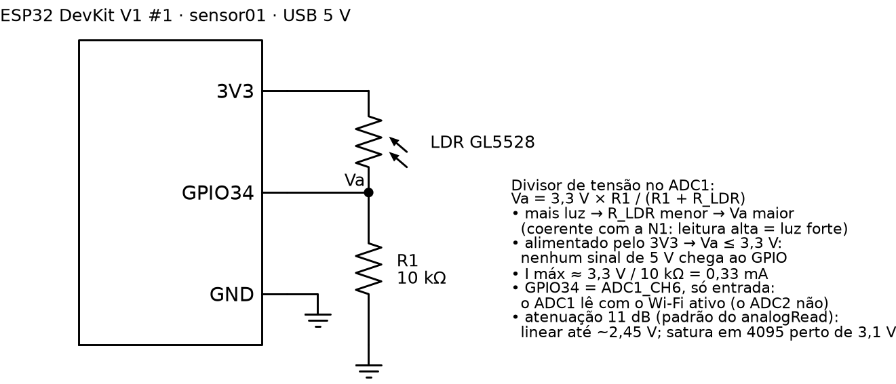
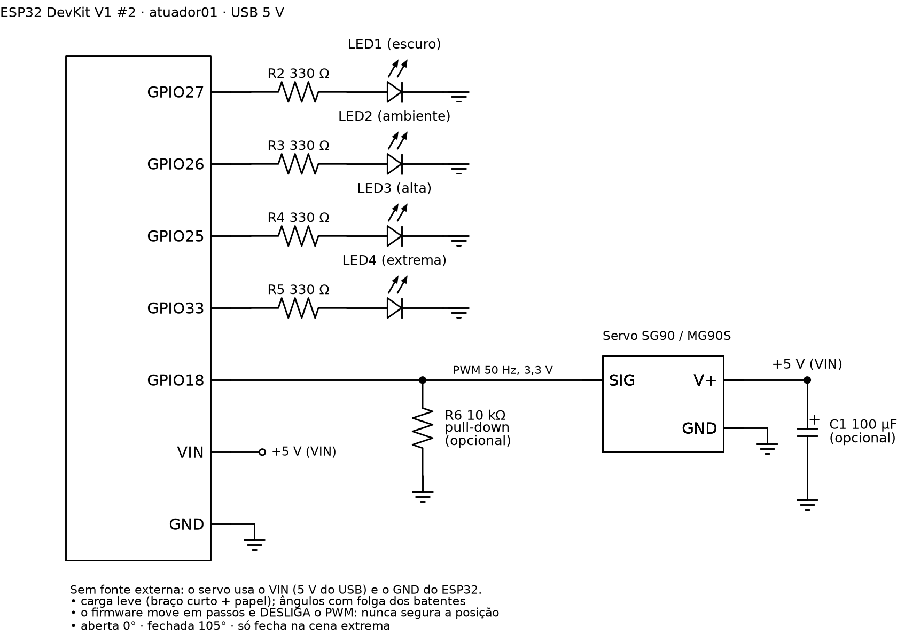

# 🌿 Luz Ambiente: proteção solar automática para plantas sensíveis

**A planta se protege sozinha do sol forte, e você acompanha e comanda pelo celular ou pelo PC.**

Plantas sensíveis (samambaias, orquídeas, mudas, suculentas recém-transplantadas) queimam as folhas quando pegam sol
direto e intenso. Quem cultiva em casa, na varanda ou numa estufa pequena não fica ao lado delas o dia todo para puxar
uma sombra na hora certa. O Luz Ambiente mede a luz que chega à planta, decide no servidor quando ela está forte demais,
fecha uma sombra com um servo, avisa no celular e guarda todo o histórico.

```
luz → LDR → ESP32 sensor01 ──MQTT (usuário+senha, ACL)──▶ Mosquitto ◀──▶ backend FastAPI ──▶ PostgreSQL
                                                              │              │  decide a cena (regra remota)
                                                              ▼              │  publica o comando com cmd_id
                                          ESP32 atuador01 ◀───┘              ▼
                                 4 LEDs + servo (sombra) ── ack/estado ──▶ interface web (login) · notificação ntfy
```

Versão defendida: **release `v3.0-n3`** (branch `SensorDeLuz`). Disciplina de Internet das Coisas, 6ª fase.

## O que o produto faz

| Para o usuário | Como |
|---|---|
| A sombra fecha sozinha no sol extremo | o backend classifica a leitura em 4 cenas (com histerese e tempo de confirmação) e comanda o atuador |
| Ver a luz agora e o histórico | painel com valor atual, gráfico, mín/máx/média, linha do tempo e exportação CSV/JSON |
| Assumir o controle | aba **Controle**: modo manual por 1/5/15 min, aplicar uma cena, voltar ao automático |
| Saber que o comando foi cumprido | cada comando mostra o ciclo **enviado → recebido → executado → confirmado** (ou rejeitado com o motivo) |
| Ser avisado de problemas | alertas na interface e **notificação no celular** (ntfy): sol extremo, sensor com falha, placa offline, modo seguro |
| Ajustar a regra | limites das cenas, histerese e tempo de confirmação editáveis pela interface (perfil admin) |

## Requisitos da N3 (piso R1–R18)

| | Requisito | Onde está |
|---|---|---|
| R1 | 2 dispositivos, entrada LDR, atuadores LED + servo, alimentação só USB | [`docs/hardware/`](docs/hardware/) (mapa de pinos, esquemas, BOM abaixo) |
| R2 | leitura não bloqueante e validada, regra local, estado seguro, reconexão, config persistente (NVS), identidade, NTP, logs | [`firmware/n3/`](firmware/n3/) |
| R3 | contrato MQTT documentado e versionado (v1.1) | [`CONTRATOS.md`](CONTRATOS.md), [`contrato/v1/`](contrato/v1/) |
| R4 | backend assina, **valida** (descarta e registra inválidas), persiste, expõe API; **único** que publica comandos | [`backend/app/v1.py`](dashboard-prototipo/backend/app/v1.py), [`control.py`](dashboard-prototipo/backend/app/control.py) |
| R5 | PostgreSQL com histórico de medições e registro de comandos; migrações versionadas | [`migrations/`](dashboard-prototipo/backend/app/migrations/) |
| R6 | interface com valor atual, histórico, último contato, online/offline, alertas e envio de comando | [`frontend/`](dashboard-prototipo/frontend/) |
| R7 | ciclo enviado/recebido/executado/confirmado, rejeição com motivo, retransmissão, idempotência | [`CONTRATOS.md` §4](CONTRATOS.md) |
| R8 | regra remota no backend com parâmetros persistidos e editáveis | tabela `decision_config`, aba Controle |
| R9 | login (token assinado); credenciais em `.env` e `secrets.h`, fora do Git | [`auth.py`](dashboard-prototipo/backend/app/auth.py) |
| R10 | 4 falhas testadas com evidência | [`docs/FALHAS.md`](docs/FALHAS.md) |
| R11 | este README, `.env.example`, release identificada | — |
| R12 | `docker compose up` sobe broker, banco, backend e interface | [`docker-compose.yml`](dashboard-prototipo/docker-compose.yml) |
| R13 | `sensor01` e `atuador01` físicos, cada um com deviceId e usuário MQTT próprios | — |
| R14 | painel analítico: gráfico por período, mín/máx/média, distribuição por cena, latência | aba Visão geral / Histórico |
| R15 | notificação externa por ntfy (ou Telegram) | [`notify.py`](dashboard-prototipo/backend/app/notify.py) |
| R16 | perfis **admin** (comanda) e **operador** (só visualiza), com recusa real na API | [`auth.py`](dashboard-prototipo/backend/app/auth.py) |
| R17 | OTA (ArduinoOTA com senha) demonstrado | [`evidencias/r17_ota_sensor.txt`](docs/evidencias/r17_ota_sensor.txt) |
| R18 | 59 testes automatizados (pytest + PostgreSQL) e CI no GitHub Actions | [`.github/workflows/ci.yml`](.github/workflows/ci.yml) |

## Como rodar

### 1. Broker, banco, backend e interface (Docker)

Pré-requisito: Docker com Compose. No Windows, libere a porta **1883** no firewall para os ESP32 alcançarem o broker.

```bash
cd dashboard-prototipo
cp .env.example .env
# edite o .env: POSTGRES_PASSWORD, MQTT_PASS_* (uma senha por dispositivo), MQTT_PASSWORD = MQTT_PASS_BACKEND,
# AUTH_USERS (admin e operador), AUTH_SECRET (openssl rand -hex 32), NTFY_URL (opcional)
docker compose up -d --build
```

Interface em `http://localhost:<HTTP_PORT>` (padrão 8081). Entre com um usuário de `AUTH_USERS`.
Testes do backend: `docker compose exec backend sh -c "pip install -r requirements-dev.txt && pytest"` com
`TEST_DATABASE_URL`, ou deixe o CI rodar a cada push.

### 2. Firmwares (Arduino IDE 2 ou arduino-cli)

- Core **esp32 by Espressif Systems** (placa *ESP32 Dev Module*), bibliotecas **PubSubClient 2.8** e **ArduinoJson 7**.
- Placas com conversor CP2102 precisam do driver **CP210x** da Silicon Labs e de um cabo USB **de dados**.
- Em `firmware/n3/Sensor_v1` e `firmware/n3/Atuador_v1`: copie `secrets.example.h` para `secrets.h` e preencha Wi-Fi,
  IP do PC (`MQTT_HOST`), a senha MQTT do dispositivo e a senha do OTA. **`secrets.h` nunca vai para o Git.**
- Identifique a placa antes de gravar (Monitor Serial a 115200): o sensor imprime `Luz: N`, o atuador imprime o modo.
- Wi-Fi e broker podem ser trocados depois pelo Serial, sem regravar: `wifi <ssid> <senha>`, `host <ip>`, `show`.

Atualização pela rede (OTA), depois da primeira gravação por USB:

```bash
arduino-cli upload -p <ip-da-placa> --protocol network --fqbn esp32:esp32:esp32 \
  --upload-field password=<OTA_PASS> firmware/n3/Sensor_v1
```

No Windows, permita o `espota.exe` no firewall (entrada), senão o upload para em "No response from device".

### Trocar de rede sem regravar (ex.: hotspot do celular)

Conecte o PC na rede nova e anote o IP dele (`ipconfig`). Em cada placa, pelo Monitor Serial (115200, "Nova linha"):

| Comando | Efeito (salvo na NVS, sobrevive ao reinício) |
|---|---|
| `wifi <ssid> <senha>` | troca a rede Wi-Fi |
| `host <ip>` | troca o endereço do broker (IP do PC com o Docker) |
| `show` | mostra versão, rede, IP, broker e se o MQTT está conectado |
| `wifioff <s>` | **teste de falha**: desliga o Wi-Fi por *s* segundos |
| `reset` · `reboot` | apaga a configuração salva · reinicia |

O ESP32 só conecta em 2,4 GHz (no iPhone, ative "Maximizar compatibilidade" no Acesso Pessoal). Se a rede nova for
marcada como pública, libere a porta 1883 no firewall do Windows.

## O que os LEDs indicam

| Placa | LED | Significado |
|---|---|---|
| sensor | azul da placa aceso | luz forte (≥ `limite_local`, padrão 1000): regra local, funciona sem rede |
| sensor | azul piscando rápido | **falha de sensor** (leitura saturada ou instável, ex.: fio solto) |
| atuador | só LED 1 · LED 2 · LED 3 | cena escuro · ambiente · alta |
| atuador | os 4 LEDs | cena extrema (a sombra fecha) |
| atuador | **LED 1 piscando devagar** | **modo SEGURO**: sem broker, backend ou sensor (normal por alguns segundos após ligar) |

## Hardware

| Nó | Ligações |
|---|---|
| `sensor01` | 3V3 → LDR GL5528 → GPIO34 → 10 kΩ → GND · LED azul da placa (GPIO2) = regra local |
| `atuador01` | GPIO27/26/25/33 → 330 Ω → LED → GND · servo: sinal GPIO18, + VIN (5 V do USB), − GND |




**BOM:** 2× ESP32 DevKit V1 (WROOM-32, CP2102) · 1× LDR GL5528 · 1× resistor 10 kΩ · 4× LED 5 mm + 4× 330 Ω ·
1× servo SG90/MG90S · protoboard 830 · jumpers · capacitor 100 µF (opcional, VIN–GND junto ao servo) · 2 cabos USB de dados.

Precauções: nenhum sinal de 5 V num GPIO; LDR só no ADC1 (o ADC2 não lê com Wi-Fi); servo com braço leve, faixa
15°–165° e **motor solto após cada movimento** (um SG90 queimou em 22/11 ao ficar travado na ponta com PWM ligado).
Detalhes em [`docs/hardware/mapa_de_pinos.md`](docs/hardware/mapa_de_pinos.md).

## Estrutura

```text
├── CONTRATOS.md                 contrato MQTT v1.1 (R3)
├── firmware/n3/                 firmwares da N3: Sensor_v1, Atuador_v1 (+ secrets.example.h)
├── firmware/n1/                 firmwares da N1 (histórico; não usam o contrato v1)
├── firmware/testes/Teste_Servo  teste e calibração do servo pelo Serial
├── dashboard-prototipo/         docker compose: Mosquitto (senha + ACL), PostgreSQL, backend FastAPI, frontend React
├── contrato/v1/                 schemas JSON e exemplos do contrato (validar.py)
├── docs/FALHAS.md               cenários de falha (R10) · docs/evidencias/ registros brutos
├── docs/hardware/               mapa de pinos e esquemas elétricos
└── (legado) backend/, firmware/esp32_*, docs/*.md antigos   outro escopo (som/presença); não usar
```

## Reaproveitamento e autoria

- Estrutura geral inspirada no projeto de referência **Sala Inteligente** da disciplina (broker + backend + banco +
  interface), com modelo de dados, regra, contrato e interface próprios do problema da planta.
- Bibliotecas: PubSubClient, ArduinoJson, ArduinoOTA e Preferences (firmware); FastAPI, asyncpg, aiomqtt, httpx
  (backend); React, Recharts e Vite (interface); Mosquitto e PostgreSQL (infraestrutura).
- Partes do código e da documentação foram escritas com auxílio de IA (Claude) e revisadas pela equipe; cada integrante
  explica as partes que usa na validação individual.

## 👥 Equipe

| Integrante | Responsabilidade |
|---|---|
| Ruan Pablo de Lima Pereira | nó sensor: divisor/ADC, fluxograma do sensor e fluxo do dado, parâmetros de decisão |
| Rodrigo Bonifácio Conceição | nó atuador: máquina de estados, intertravamento, servo |
| Vinicius Clemente Negherbon | contrato MQTT v1, repositório, integração da N3 |
| Bianca Barp | esquema elétrico, BOM, mapa de pinos, revisão do documento |
| Guilherme Pietro | arquitetura-alvo, fluxo do comando, protótipo do dashboard, plano de falhas, cronograma e riscos |

Projeto acadêmico, sem licença de software definida.
